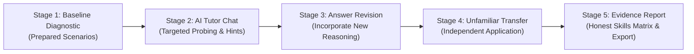
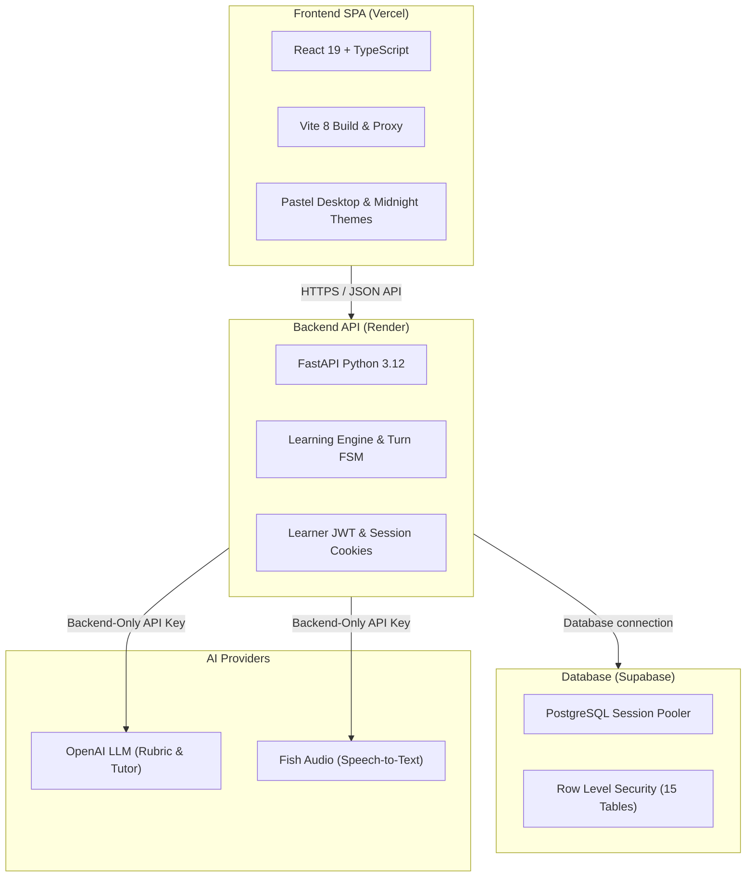

# Concept Check 💾

> **Explain backend mechanisms from first principles, explore reasoning gaps through guided dialogue, and assess evidence of independent application on unfamiliar cases.**

[](https://concept-check-sam-c207.vercel.app)
[](https://concept-check-api.onrender.com/health)
[](https://supabase.com)
[](https://python.org)
[](https://react.dev)
[](#verification)

---

## 🌐 Live Deployments

| Component | Provider | URL | Notes |
| :--- | :--- | :--- | :--- |
| **Frontend Application** | Vercel | [https://concept-check-sam-c207.vercel.app](https://concept-check-sam-c207.vercel.app) | Production SPA with automated rewrites for `/v1` and `/health` |
| **Alternate Frontend Address** | Vercel | [https://concept-check-flax.vercel.app](https://concept-check-flax.vercel.app) | Alias for the same production frontend |
| **Backend REST API** | Render | [https://concept-check-api.onrender.com](https://concept-check-api.onrender.com) | FastAPI; the repository pins Python 3.12.7 |
| **Database** | Supabase | PostgreSQL session pooler | Accessed by the trusted backend; see the access model below |

---

## 🎯 The Problem & Pedagogical Philosophy

A learner may repeat a familiar explanation without being able to predict what happens in a new situation. Concept Check investigates that uncertainty using explanations, focused follow-ups and prepared unfamiliar cases.

- **Reasoning and evidence:** Quotes are verified against saved learner answers when available. An omitted answer part has no invented quotation.
- **Clarification before diagnosis:** Ambiguity or an omission does not automatically establish a misconception.
- **Prepared assessment criteria:** AI proposes criterion-level judgments against authored reference answers; its judgments remain provisional until human review.
- **Separate exercise checks:** Diagram and cloze selections are checked separately from conceptual reasoning. A correct selection alone does not prove understanding.
- **Independent application:** Supported revisions and unfamiliar-case answers remain separate evidence. The app does not establish mastery or long-term retention.

---

## 🔄 Four Learning Steps and an Evidence Report



### 1. Baseline Diagnostic
- Learners answer multi-case scenarios involving process memory, server restarts, and disk persistence.
- **Task Accent Cards (`🎯 Your Task`):** Visually isolates the prompt question from background system descriptions and explicit assumptions.
- **Prepared Exercises:** Some cases include preset diagrams or cloze selections alongside the required written reasoning. Selection accuracy is assessed separately.

### 2. Socratic AI Tutor Investigation
- Immediate post-diagnostic summary outlines demonstrated claims and specific areas needing clarification.
- A separate tutoring workspace contains one active composer. The verified sentence being investigated and its initial follow-up appear together; missing quotations are labelled explicitly.
- **Hint-First Policy:** The tutor is instructed to offer conceptual clues before explanations and aim for concise replies under 160 words; model responses can vary.
- **Accessible Help Menu:** Keyboard-navigable WAI-ARIA menu for requesting hints, concept guides, scenario clarifications, or correcting tutor misunderstandings.
- **Waiting Feedback:** Timed progress messages describe expected processing steps while the request is pending; they are not backend-confirmed progress events.

### 3. Dedicated Revision Workspace
- Available through the **"💡 Ready to update your answer?"** callout in the tutoring workspace; the learner chooses when to revise.
- Drafts are kept per session and action in browser-tab `sessionStorage`, preserving them across view changes and refreshes in that tab. Separate browser tabs do not share drafts.

### 4. Unfamiliar Transfer Challenge
- Features a **Concept Focus Anchor** badge reminding learners of the core principle under test.
- Presents a brand-new scenario (e.g., stale price cache vs. authoritative database) to test whether understanding transfers without coaching.

### 5. Comprehensive Evidence Report
- **Accurate Session Status:** The banner says **"Session saved"** and lists submitted answers, tutoring activity, unattempted stages and assessment availability. Ending a session does not imply that every step was completed or passed.
- **Personal Summary Grid:** Categorizes what was demonstrated, missing/incorrect, changed after help, and recommended next steps.
- **Matched Skills Matrix:** Compares matching skills across baseline, supported revision and the unfamiliar case using visual color-coded pills (Green / Yellow / Gray).
- **Question-Part Coverage & Appendix:** Lists exact learner quotes, grading justifications, all submitted attempts, support history, and full saved conversation transcript.
- **A4 Print / PDF Export:** Dedicated Compact Summary vs. Full Appendix views with comprehensive print styling (`@media print`).

---

## 🎙️ Speech-to-Text Voice Dictation

Concept Check uses **Fish Audio ASR** (configurable; default `transcribe-1-pro`) to suggest editable transcripts:
- **Annotation Cleanup:** Hides recognised pause and speaker annotations in the initial editable draft, with safeguards for code, JSON and meaningful times. This is text cleanup, not audio denoising or background-voice removal. Unknown annotations may remain; the learner can inspect and restore the original.
- **Dual Transcript Provenance:** Retains the provider's `raw_transcript` alongside an editable `cleaned_transcript`.
- **Append-by-Default:** New recordings append to current drafts; learners can explicitly review, edit, cancel, or replace text before manual submission.

---

## 🛡️ Staff Reviewer Desk

A dedicated reviewer interface (`/v1/review/*`) enables human instructors to audit and correct provisional AI judgments:
- **Staff Credential:** Staff enter a separate reviewer key in the browser. It is held in memory and sent to the backend using `X-Reviewer-Key`; it is not bundled or saved in browser storage. Provider API keys remain backend-only.
- **Immutable Case Versioning:** Case prompts, rubrics, and criteria are versioned and immutable. Human reviewers can review or reject revisions with an append-only audit trail.
- **Preserved Lineage:** Startup database seeding honors human-reviewed or rejected rows and will not overwrite them with shipped defaults.

---

## 🏗️ Architecture & Technology Stack



* **Frontend:** React 19, TypeScript, React Router 7, Vite 8, CSS custom properties, responsive layouts and keyboard-accessible controls. A comprehensive accessibility audit has not been established.
* **Backend:** FastAPI, SQLAlchemy 2.0 ORM, Pydantic v2 Settings, Python 3.12.7 pinned runtime.
* **Database:** PostgreSQL on Supabase (Session Pooler port 5432), migration tooling with Alembic and runtime column inspection (`ensure_schema_columns`).
* **Access model:** Learner authentication uses application-managed accounts and JWTs, not Supabase Auth. FastAPI enforces per-user ownership. The backend-only database migration revokes public-role table access and enables RLS; the privileged backend retains access. RLS alone does not enforce per-learner isolation for that backend connection. Production CORS uses an explicit origin allowlist, and provider keys stay on the backend.

---

## 📚 Concept Catalogue & Content Bank

The catalogue includes 7 active concepts spanning Module 2 backend reasoning:
* **Module A:** Request anatomy, backend validation and secret placement.
* **Module B:** Storage & persistence; save, retrieve, display.
* **Module C:** Entities & attributes; one-to-many relationships.

**Content scope:** 60 authored scenarios, 19 preset diagrams and 8 cloze exercises. Storage & persistence is the featured demo. Shipped cases, resources and answer criteria are AI-authored and await human review; automated checks do not establish their educational validity.

---

## 🚀 Local Development Setup

### Prerequisites
- **Python 3.12.7**, matching the repository's `.python-version` files.
- **Node.js 22.12+** and npm. The installed Vite version also supports Node 20.19+; earlier Node 20 versions are insufficient.

### 1. Backend setup
Start in the repository root. These commands use PowerShell:

```powershell
python -m venv backend/.venv
.\backend\.venv\Scripts\Activate.ps1
python -m pip install -r backend/requirements-dev.txt
# First setup only; keep an existing .env if you already configured it.
Copy-Item backend/.env.example backend/.env
```

Edit `backend/.env` privately using the variable reference below. Configure a persistent `SECRET_KEY` and your provider keys. For isolated local development, leave `DATABASE_URL` unset to use SQLite; avoid pointing development at real learner data. The server can start without provider keys, but live AI tutoring/assessment or dictation will be unavailable.

Run from the backend directory so the application loads `backend/.env`:

```powershell
Set-Location backend
python -m uvicorn app.main:app --host 127.0.0.1 --port 8000 --workers 1
```

Startup creates/updates the configured database schema and seeds prepared content. Use **one backend worker**: cross-process duplicate-turn coordination is not implemented. Health: [http://localhost:8000/health](http://localhost:8000/health). Interactive API docs: [http://localhost:8000/docs](http://localhost:8000/docs).

### 2. Frontend setup
Open a second terminal in the repository root:

```powershell
Set-Location frontend
npm.cmd ci
npm.cmd run dev
```

Open [http://localhost:5173](http://localhost:5173). Vite proxies `/v1` and `/health` to the backend on port 8000.

### 3. Try the learner flow
Create an account, choose **Storage & persistence**, and submit the diagnostic answers. Review the summary, continue to tutor chat, optionally revise, then answer the unfamiliar case. Open the evidence report and revisit the saved session through the catalogue. Some sessions can proceed directly to a fresh case when no concern is found; revision can be skipped, and an early finish leaves remaining stages unassessed.

---

<a id="verification"></a>
## 🧪 Verification

Run these commands from the repository root after the setup above. They cover saved evidence, ownership, turn recovery, authored content and frontend rendering; they do not establish AI grading accuracy or real learner improvement.

```powershell
# Backend checks, using the installed development dependencies
Push-Location backend
python -m pytest -q
Pop-Location

# Frontend checks and production build
npm.cmd --prefix frontend run test:ui
npm.cmd --prefix frontend run lint
npm.cmd --prefix frontend run build
```

Backend tests configure an isolated in-memory database and disable provider credentials. The frontend checks use Node's test runner, React rendering and the installed TypeScript compiler; they are not browser or microphone tests. Test totals are deliberately not represented by a static passing badge.

### Validation still needed
- Human review of the authored cases, reference answers and provisional assessments.
- Real classmate and stranger sessions, including an unseen case before help and a different unseen case afterward.
- Real microphone/transcription quality and usability across screen sizes and themes.

Automated or synthetic browser runs check software behaviour; they do not replace real-user evidence. Local scratch scripts and screenshots are not part of the published repository.

---

## 🔒 Configuration Variable Reference

> [!IMPORTANT]
> Configuration variable names only — never commit credentials or provider keys. All external provider calls are backend-only.

| Variable Name | Required | Purpose |
| :--- | :---: | :--- |
| `DATABASE_URL` | Optional locally; configure for deployment | SQLAlchemy connection URI; defaults to a local SQLite file |
| `SECRET_KEY` | Required in production; recommended locally | Persistent signing secret for JWTs and session tokens; production requires at least 32 characters |
| `OPENAI_API_KEY` | Required for live AI features | Rubric assessment, gap analysis and tutor turns; missing configuration produces explicit unavailable states |
| `OPENAI_MODEL` | Optional | Model selection; see the current default in `backend/app/config.py` and choose an available model for your account |
| `FISH_AUDIO_API_KEY`| No | Fish Audio API key for speech-to-text dictation |
| `FISH_AUDIO_MODEL` | No | Target Fish Audio model ID (default: `transcribe-1-pro`) |
| `REVIEWER_API_KEY` | No | Optional key required to access staff reviewer endpoints |
| `CORS_ORIGINS` | Configure for deployment | Comma-separated exact frontend origins; local default is the Vite localhost origin |
| `ENVIRONMENT` | Configure for deployment | Selects development or production security behaviour; defaults to development |

---

## 📄 License

No license file is currently included in this repository.
