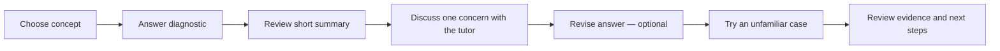
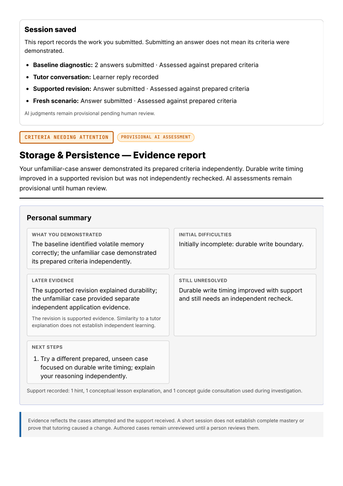
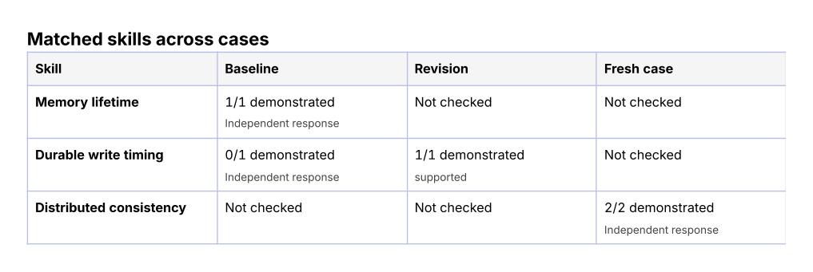
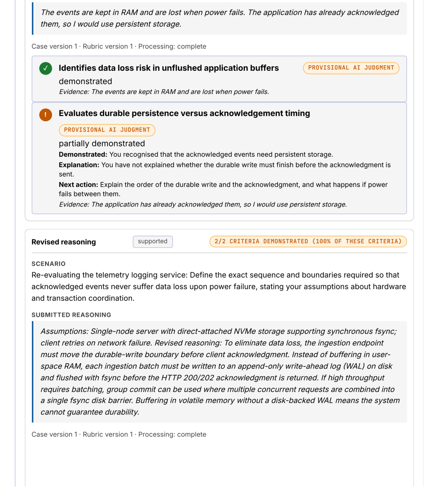
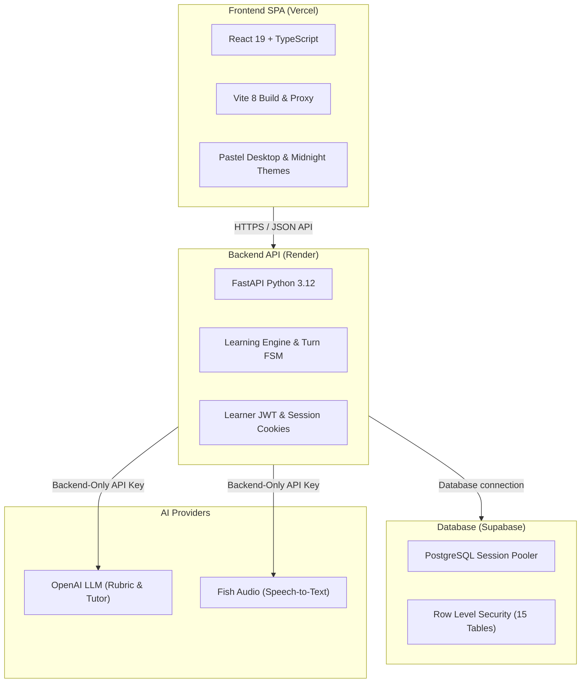

# Concept Check 💾

> **Explain what you think happens, investigate the parts you missed, and try your reasoning on a different scenario.**

Concept Check is a learning and assessment prototype for backend concepts. It combines scenario questions, diagrams, editable voice input and a separate AI tutor chat. Its report shows **what you initially explained, what changed after help, and what you could apply independently**.

**Start here:** [Open the app](https://concept-check-flax.vercel.app) → create an account → choose **Storage & persistence** → answer the diagnostic in your own words. You do not need to write a perfect answer before asking for clarification.

[How a learner improves](#how-a-learner-improves) · [Capabilities](#capabilities) · [Example reports](#example-reports) · [Local setup](#local-setup) · [Verification](#verification)

[](https://concept-check-sam-c207.vercel.app)
[](https://concept-check-api.onrender.com/health)
[](https://supabase.com)
[](https://python.org)
[](https://react.dev)
[](#verification)

---

## 🌐 Live Deployments

| Component | Provider | URL | Notes |
| :--- | :--- | :--- | :--- |
| **Frontend Application** | Vercel | [https://concept-check-sam-c207.vercel.app](https://concept-check-sam-c207.vercel.app) | Production SPA with automated rewrites for `/v1` and `/health` |
| **Alternate Frontend Address** | Vercel | [https://concept-check-flax.vercel.app](https://concept-check-flax.vercel.app) | Alias for the same production frontend |
| **Backend REST API** | Render | [https://concept-check-api.onrender.com](https://concept-check-api.onrender.com) | FastAPI; the repository pins Python 3.12.7 |
| **Database** | Supabase | PostgreSQL session pooler | Accessed by the trusted backend; see the access model below |

---

## 🎯 The Problem & Pedagogical Philosophy

A learner may repeat a familiar explanation without being able to predict what happens in a new situation. Concept Check investigates that uncertainty using explanations, focused follow-ups and prepared unfamiliar cases.

- **Reasoning and evidence:** Quotes are verified against saved learner answers when available. An omitted answer part has no invented quotation.
- **Clarification before diagnosis:** Ambiguity or an omission does not automatically establish a misconception.
- **Prepared assessment criteria:** AI proposes criterion-level judgments against authored reference answers; its judgments remain provisional until human review.
- **Equivalent reasoning:** Assessment instructions accept correct mechanisms explained in ordinary language. Missing words such as “authoritative” or “durable” should not alone lose credit; separately requested reasoning still needs evidence. This is model guidance, not a guarantee of grading accuracy.
- **Separate exercise checks:** Diagram and cloze selections are checked separately from conceptual reasoning. A correct selection alone does not prove understanding.
- **Independent application:** Supported revisions and unfamiliar-case answers remain separate evidence. The app does not establish mastery or long-term retention.

---

<a id="how-a-learner-improves"></a>
## 🔄 How a Learner Improves

The diagnostic is saved first. The learner sees a short summary, then continues to a **separate tutor chat**. The form, conversation, revised answer and unfamiliar case are separate parts of the journey.



### A Concrete Example: “Will My Notes Survive a Restart?”

The following is an **illustrative learning example**, not a recorded learner result.

**Scenario:** A FastAPI app stores notes only in a Python list. The server restarts. Assume no file or database write has occurred. Explain whether these notes survive, then propose how a redesigned app should save notes and restore them at startup.

| Step | What the learner experiences | Why it helps |
| :--- | :--- | :--- |
| **1. Explain first** | “The notes disappear because the Python list is in RAM. I would use a database.” | Captures the learner's own starting reasoning before tutoring. |
| **2. Identify the missing part** | Feedback can recognise the correct memory explanation while pointing out that the startup recovery path has not been explained. | “You missed this part” is different from “your whole answer is wrong.” |
| **3. Clarify and discuss** | An illustrative follow-up is: “What should the application read when it starts, and where should those records go?” The learner can reply, request a hint, or correct the tutor's interpretation. | Gives the learner a chance to explain an omission before it is treated as a conceptual gap. |
| **4. Revise with support recorded** | “The original list is lost. If notes were saved to PostgreSQL before the restart, startup must query those saved records and load the returned data into the application's state.” | Makes the corrected mechanism explicit. The original answer and any help remain saved. |
| **5. Apply it elsewhere** | A different prepared case might use saved chat messages rather than notes. The learner explains independently what survives and what must be reloaded. | Checks application in another context. The actual case and criteria come from the authored bank. |
| **6. Read the evidence** | The report separates the initial omission, the supported revision, the unfamiliar-case evidence and anything still untested. | Shows what improved and what needs another check without claiming mastery. |

An answer that repeats a tutor explanation is **supported evidence**. A later unfamiliar-case answer provides separate evidence of application when it is completed independently. Neither establishes long-term retention or proves that the tutor caused learning.

### What Happens When Something Is Unclear?

- **The question is unclear:** Ask AI to clarify its wording or stated assumptions. This action uses the current public scenario and recent clarification turns; the model is instructed not to reveal solutions or invent conditions. It is distinct from requesting a teaching hint.
- **The tutor misunderstood:** Correct its interpretation and explain what you meant. An uncertain interpretation should not automatically become a confirmed misconception.
- **A revision conflicts with earlier reasoning:** When matching criterion judgments for the same case and version change from demonstrated to an explicit incorrect claim, the app saves the revision and asks for clarification before automatically advancing. The learner can return to chat, revise again, or explicitly proceed. This flags assessment disagreement; it does not prove that someone lost understanding or detect every contradiction in free text.
- **A part was omitted:** The feedback can name the requested part that was not answered and suggest what to explain next. It does not invent a quotation for an absent answer.
- **The assessment failed technically:** The report marks the judgment unavailable and offers reassessment. This is an assessment issue, not a learner mistake.
- **No gap was identified:** The learner can finish without unnecessary remediation. Skipped stages remain unassessed.

**Example revision warning:** Suppose the original answer correctly explains that RAM is temporary, but the revised answer selects RAM as the persistent save destination. The app can ask:

> “Your revision is saved, but its assessment is inconsistent with your earlier reasoning. Could you clarify what you intended in the revised answer?”

The tutor can then explore whether the learner meant **saving permanently** or **loading into memory after restart**, while preserving both submissions. A brief explanation in chat is not silently substituted for the submitted revision.

### How Assistance Is Recorded

The tutor returns an assistance label alongside its message in the same AI call. The backend records tutor-declared **teaching**, **hint**, or **follow-up** content rather than deriving the label only from the clicked button. For example, a direct explanation after “Request a hint” can be recorded as teaching. Unclassified or legacy plain responses are labelled **tutoring with type not recorded**; failed responses do not count as delivered help. This model-proposed classification needs review, and older saved events are not retroactively reclassified.

<a id="capabilities"></a>
## ✨ What the App Can Do

| Capability | What it means for the learner |
| :--- | :--- |
| **Choose a concept and a prepared scenario** | Work from explicit assumptions and question parts across Modules A, B and C. |
| **Type or speak an explanation** | Review and edit a voice transcript before submitting. Additional recordings append by default; replacement is an explicit choice. |
| **Reason with diagrams and cloze exercises** | Complete or repair preset diagrams and fill prepared blanks where included in a case. Written reasoning is assessed separately from selections. |
| **Review a diagnostic summary** | See demonstrated reasoning and areas needing clarification before entering the chat workspace. |
| **Discuss a specific concern** | See the saved source sentence when available and answer a focused follow-up. Earlier diagnostic submissions remain accessible without filling the active chat. |
| **Ask for the right kind of help** | Request a hint, explanation, guided practice or resource; clarify a scenario or correct an interpretation. The tutor is instructed to start with hints and keep replies concise. |
| **Revise without losing the first answer** | Preserve submitted attempts, their order and the assistance provided. Drafts survive refreshes in the same browser tab. |
| **Clarify an inconsistent revision** | Save a conflicting revision and discuss the difference before automatically moving to the unfamiliar case; proceeding remains the learner's choice. |
| **Try a different prepared case** | Apply the concept against authored criteria. Support provenance distinguishes an independent response from a prompted one. |
| **Review and export evidence** | Read the summary and skill comparison, expand detailed evidence, and print a compact summary or full appendix. |
| **Revisit saved sessions** | Sign in to return to earlier attempts and compare recorded reasoning across sessions. |
| **Have judgments reviewed** | Staff can inspect and correct provisional AI assessments through the reviewer desk. |

Tutor replies can include text/ASCII diagrams; diagram exercises in the form use **prepared presets**. Model-generated text diagrams are explanatory output and are not automatically verified exercise diagrams.

<a id="example-reports"></a>
## 📊 What the Report Shows

The report answers three practical questions: **What did I explain correctly? What is still missing? What should I try next?**

The images below are rendered from the application's current report component using **fictional demonstration data and illustrative feedback**. They are examples of the report layout, not real learner records or evidence that someone learned. The durable-write example shown here is separate from the introductory notes example above.

### 1. A Summary That Separates Earlier Difficulties From Current Gaps

The summary distinguishes what was initially omitted or unclear from later matching evidence. It labels a revision as supported evidence, keeps assessment failures separate, and retains multiple next steps when needed—for example, a new case **and** reassessment of an unavailable judgment.

The latest report also identifies **starting strengths demonstrated before tutoring** and displays **“Revision needs clarification”** when matching saved assessments conflict. These details help distinguish existing knowledge, later application and unresolved interpretation. The screenshots below illustrate the layout; these newer fields appear when the session contains the relevant evidence.



### 2. A Skill Comparison Across Attempts

Compare each skill across baseline, revision and unfamiliar case. **Not checked** means that stage did not supply evidence for that skill. It does not mean the learner got it wrong. A supported revision alone does not clear the need for an independent recheck.

Resolving a specific concern requires matching criterion evidence, not just a shared broad skill label. For example, explaining how a cache reloads from a database does not automatically resolve a separate concern about why the old process memory disappears. A later skill success can remain visible while the original requirement stays open.



### 3. The Evidence Behind the Summary

Expand the appendix to inspect original prompts, submitted answers, question-part feedback, criterion judgments, recorded assistance and the saved conversation. Feedback can distinguish a correct claim from a missing requested part, explain the concern, and suggest a next action. AI judgments remain provisional until human review.

<details>
<summary>View an example page of preserved answers and criterion evidence</summary>



</details>

**Export options:** Compact summary keeps the personal summary and skill table; full report includes the detailed appendix. Expanding evidence on screen does not add it to the compact printout. Page count depends on the session length.

**What the report does not measure:** A count such as “2/2 criteria demonstrated” describes the prepared criteria assessed in that answer. It is not a percentage of overall understanding or a measured learning gain. Technical failures, uncertain judgments and skills not rechecked must remain visible.

An **inconclusive** result names its cause where recorded: incomplete initial gap analysis, missing criterion evidence or processing, uncertain judgments, or technical assessment failures. Initial gap analysis and criterion assessment are separate operations; one failing does not make the other operation's saved judgments disappear.

---

## 🎙️ Speech-to-Text Voice Dictation

Concept Check uses **Fish Audio ASR** (configurable; default `transcribe-1-pro`) to suggest editable transcripts:
- **Annotation Cleanup:** Hides recognised pause and speaker annotations in the initial editable draft, with safeguards for code, JSON and meaningful times. This is text cleanup, not audio denoising or background-voice removal. Unknown annotations may remain; the learner can inspect and restore the original.
- **Dual Transcript Provenance:** Retains the provider's `raw_transcript` alongside an editable `cleaned_transcript`.
- **Append-by-Default:** New recordings append to current drafts; learners can explicitly review, edit, cancel, or replace text before manual submission.

---

## 🛡️ Staff Reviewer Desk

A dedicated reviewer interface (`/v1/review/*`) enables human instructors to audit and correct provisional AI judgments:
- **Staff Credential:** Staff enter a separate reviewer key in the browser. It is held in memory and sent to the backend using `X-Reviewer-Key`; it is not bundled or saved in browser storage. Provider API keys remain backend-only.
- **Immutable Case Versioning:** Case prompts, rubrics, and criteria are versioned and immutable. Human reviewers can review or reject revisions with an append-only audit trail.
- **Preserved Lineage:** Startup database seeding honors human-reviewed or rejected rows and will not overwrite them with shipped defaults.

---

## 🏗️ Architecture & Technology Stack



* **Frontend:** React 19, TypeScript, React Router 7, Vite 8, CSS custom properties, responsive layouts and keyboard-accessible controls. A comprehensive accessibility audit has not been established.
* **Backend:** FastAPI, SQLAlchemy 2.0 ORM, Pydantic v2 Settings, Python 3.12.7 pinned runtime.
* **Database:** PostgreSQL on Supabase (Session Pooler port 5432), migration tooling with Alembic and runtime column inspection (`ensure_schema_columns`).
* **Access model:** Learner authentication uses application-managed accounts and JWTs, not Supabase Auth. FastAPI enforces per-user ownership. The backend-only database migration revokes public-role table access and enables RLS; the privileged backend retains access. RLS alone does not enforce per-learner isolation for that backend connection. Production CORS uses an explicit origin allowlist, and provider keys stay on the backend.

---

## 📚 Concept Catalogue & Content Bank

The catalogue includes 7 active concepts spanning Module 2 backend reasoning:
* **Module A:** Request anatomy, backend validation and secret placement.
* **Module B:** Storage & persistence; save, retrieve, display.
* **Module C:** Entities & attributes; one-to-many relationships.

**Content scope:** 60 authored scenarios, 19 preset diagrams and 8 cloze exercises. Storage & persistence is the featured demo. Shipped cases, resources and answer criteria are AI-authored and await human review; automated checks do not establish their educational validity.

---

<a id="local-setup"></a>
## 🚀 Local Development Setup

### Prerequisites
- **Python 3.12.7**, matching the repository's `.python-version` files.
- **Node.js 22.12+** and npm. The installed Vite version also supports Node 20.19+; earlier Node 20 versions are insufficient.

### 1. Backend setup
Start in the repository root. These commands use PowerShell:

```powershell
python -m venv backend/.venv
.\backend\.venv\Scripts\Activate.ps1
python -m pip install -r backend/requirements-dev.txt
# First setup only; keep an existing .env if you already configured it.
Copy-Item backend/.env.example backend/.env
```

Edit `backend/.env` privately using the variable reference below. Configure a persistent `SECRET_KEY` and your provider keys. For isolated local development, leave `DATABASE_URL` unset to use SQLite; avoid pointing development at real learner data. The server can start without provider keys, but live AI tutoring/assessment or dictation will be unavailable.

Run from the backend directory so the application loads `backend/.env`:

```powershell
Set-Location backend
python -m uvicorn app.main:app --host 127.0.0.1 --port 8000 --workers 1
```

Startup creates/updates the configured database schema and seeds prepared content. Use **one backend worker**: cross-process duplicate-turn coordination is not implemented. Health: [http://localhost:8000/health](http://localhost:8000/health). Interactive API docs: [http://localhost:8000/docs](http://localhost:8000/docs).

### 2. Frontend setup
Open a second terminal in the repository root:

```powershell
Set-Location frontend
npm.cmd ci
npm.cmd run dev
```

Open [http://localhost:5173](http://localhost:5173). Vite proxies `/v1` and `/health` to the backend on port 8000.

### 3. Try the learner flow
Create an account, choose **Storage & persistence**, and submit the diagnostic answers. Review the summary, continue to tutor chat, optionally revise, then answer the unfamiliar case. Open the evidence report and revisit the saved session through the catalogue. Some sessions can proceed directly to a fresh case when no concern is found; revision can be skipped, and an early finish leaves remaining stages unassessed.

---

<a id="verification"></a>
## 🧪 Verification

Run these commands from the repository root after the setup above. They cover saved evidence, ownership, turn recovery, authored content and frontend rendering; they do not establish AI grading accuracy or real learner improvement.

```powershell
# Backend checks, using the installed development dependencies
Push-Location backend
python -m pytest -q
Pop-Location

# Frontend checks and production build
npm.cmd --prefix frontend run test:ui
npm.cmd --prefix frontend run lint
npm.cmd --prefix frontend run build
```

Backend tests configure an isolated in-memory database and disable provider credentials. The frontend checks use Node's test runner, React rendering and the installed TypeScript compiler; they are not browser or microphone tests. Test totals are deliberately not represented by a static passing badge.

### Validation still needed
- Human review of the authored cases, reference answers and provisional assessments.
- Real classmate and stranger sessions, including an unseen case before help and a different unseen case afterward.
- Real microphone/transcription quality and usability across screen sizes and themes.

Automated or synthetic browser runs check software behaviour; they do not replace real-user evidence. Local scratch audits and private learner exports are not published. The report illustrations in this README use fictional fixtures.

---

## 🔒 Configuration Variable Reference

> [!IMPORTANT]
> Configuration variable names only — never commit credentials or provider keys. All external provider calls are backend-only.

| Variable Name | Required | Purpose |
| :--- | :---: | :--- |
| `DATABASE_URL` | Optional locally; configure for deployment | SQLAlchemy connection URI; defaults to a local SQLite file |
| `SECRET_KEY` | Required in production; recommended locally | Persistent signing secret for JWTs and session tokens; production requires at least 32 characters |
| `OPENAI_API_KEY` | Required for live AI features | Rubric assessment, gap analysis, tutor turns and scenario clarification; missing configuration produces explicit unavailable states |
| `OPENAI_MODEL` | Optional | Model selection; see the current default in `backend/app/config.py` and choose an available model for your account |
| `FISH_AUDIO_API_KEY`| No | Fish Audio API key for speech-to-text dictation |
| `FISH_AUDIO_MODEL` | No | Target Fish Audio model ID (default: `transcribe-1-pro`) |
| `REVIEWER_API_KEY` | No | Optional key required to access staff reviewer endpoints |
| `CORS_ORIGINS` | Configure for deployment | Comma-separated exact frontend origins; local default is the Vite localhost origin |
| `ENVIRONMENT` | Configure for deployment | Selects development or production security behaviour; defaults to development |

---

## 📄 License

No license file is currently included in this repository.
